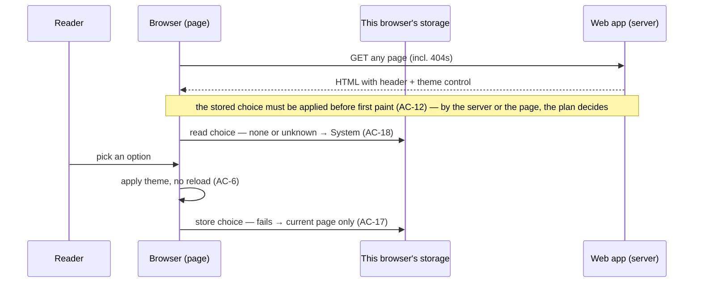

# Theme toggle (light / dark)

**Status:** approved (user · 2026-10-23)
**Ticket:** none
**Areas:** apps/web

## Goal
Today the blog's colours follow only the operating system's `prefers-color-scheme` (S-3). A reader who wants dark pages on a light OS (or the reverse) has no way to get them. The posts-list spec ruled out a manual toggle (S-7). This feature adds a theme control to every page. The reader's choice is kept in their browser and is in place from the first painted frame. A reader who never uses the control keeps the system behaviour (S-1, S-2).

## Non-goals
- Themes beyond light and dark: high contrast, sepia, custom accents (inferred).
- A new or changed palette. Explicit Light and Dark reuse the existing token sets (A-1).
- Storing the choice on a server or per account. There are no accounts (S-7, A-4).
- Theme variants of cover images: dimming, filters, alternate dark covers (A-9).
- Live sync of a new choice into other open tabs (A-8, P-1 deferred).
- Print-specific colours (inferred).

## Sources
| ID | Source | What it contributes |
|---|---|---|
| S-1 | request — user text, 2026-10-23 | "a dark and light theme toggle", built from the current branch |
| S-2 | request — caller's brief, 2026-10-23 | system preference as the default; explicit choice and its persistence; no flash on first paint (SSR / no-JS); reachable on every page incl. not-found; keyboard, accessible name/state, contrast, reduced motion; covers and colours in both themes |
| S-3 | existing — `apps/web/src/app/globals.css:1-29` | light tokens (`:root`) and dark tokens under `@media (prefers-color-scheme: dark)`. The only colour source; components use `var(--…)` only |
| S-4 | existing — `apps/web/src/app/layout.tsx:11-34` | `colorScheme: 'light dark'`; root layout renders skip link, header with site name "Blog" → `/posts`, `main` on every page |
| S-5 | existing — `apps/web/src/app/not-found.tsx:1-2`, `apps/web/src/app/posts/not-found.tsx:4-17`, `apps/web/src/proxy.ts:11-25` | one not-found UI (noindex, "Go to the first page") for unmatched URLs and the proxy's 404 rewrite; proxy matcher is `/posts` only |
| S-6 | existing — `apps/web/public/covers/cover-1…4.webp` (1600×900), `apps/web/src/app/posts/_components/PostCard/PostCard.module.css:12-16` | covers are mid-tone gradients with no text; the cover box background is the `--placeholder` token |
| S-7 | `docs/specs/posts-list.md` (approved) | A-13 targets (WCAG 2.2 AA, CLS ≤ 0.1, 24×24 px); A-22 web checks by demo; A-23 manual toggle out of scope then; AC-1, AC-12, NFR-4, NFR-6, NFR-7, NFR-8, NFR-12 |
| S-8 | existing — `INSIGHTS.md:23,27` | proxy and pages are separate bundles; a page-thrown 404 renders a blank shell without JS, so 404s go through the proxy rewrite |
| S-9 | request — user answers, 2026-10-23 | three options System / Light / Dark; without JS the control is hidden and the OS preference applies, no new web route |
| S-10 | request — user decision on plan REC-2, 2026-10-23 | the theme options also respond to the arrow keys (native radio-group behaviour) |

## User stories
### US-1 — Pick a theme (P1)
As a reader, I want to switch the site to light or dark from any page, so that I can read comfortably whatever my OS setting is.
**Independent test:** on a light OS, open `/posts` and pick "Dark". The page turns dark at once with no reload. Repeat on `/nope` (404).

### US-2 — Keep my choice (P1)
As a reader, I want my choice remembered on this browser and applied from the first frame, so that I am never flashed with the other theme.
**Independent test:** pick "Dark" on a light OS, close the browser, reopen `/posts?page=2` with throttled CPU. No frame of the recording is light.

### US-3 — Follow the system by default (P1)
As a reader who never touches the control, I want the site to keep following my OS, including without JavaScript, so that nothing changes for me.
**Independent test:** clean profile on a dark OS: the page is dark and "System" is selected. With JS disabled the page is still dark.

### US-4 — Use the control by keyboard and screen reader (P1)
As a keyboard or screen-reader user, I want to reach the control, hear its name and state, and change it, so that the feature is usable without a mouse.
**Independent test:** Tab from page load reaches the control third, and a screen reader announces "Theme" and the selected option. Space switches it.

## Contract
- **Routes / APIs:** none; no new web route (user · 2026-10-23, S-9). The API is not involved.
- **Shared schemas:** none. The option set `system | light | dark` lives in the web app only.
- **Tools / commands:** none.
- **UI surface:** a theme control in the site header of every page the root layout renders (S-4). That includes unmatched URLs and the `/posts` proxy's 404 rewrite (S-5, S-8). The control is placed and named per A-2, A-3. It switches between the two existing token sets (S-3, A-1).
- **Persistence:** the reader's choice, per browser, on the device (A-4). No database, no migration.

### Module interaction

## Acceptance criteria
**Control (US-1)**
- **AC-1** (US-1 · S-2, A-2) The site header of every page SHALL contain one theme control named "Theme".
- **AC-2** (US-1 · S-9, A-3) The theme control SHALL offer exactly three options: "System", "Light" and "Dark" (user · 2026-10-23).
- **AC-3** (US-1 · S-1, A-1) WHEN the reader picks "Dark", the page SHALL render with the dark token set whatever the OS preference.
- **AC-4** (US-1 · S-1, A-1) WHEN the reader picks "Light", the page SHALL render with the light token set whatever the OS preference.
- **AC-5** (US-1 · S-2, S-9) WHEN the reader picks "System", the page SHALL render with the token set matching the OS preference.
- **AC-6** (US-1 · S-2) WHILE JavaScript is enabled, WHEN the reader picks an option, the page SHALL apply it without a page reload.
- **AC-7** (US-1 · A-5) WHEN the theme changes, the page SHALL show the new colours with no animated transition.
- **AC-8** (US-1 · S-4) WHILE "Light" or "Dark" is selected, the document's computed `color-scheme` SHALL be that scheme alone.
- **AC-9** (US-1 · S-5, S-8) WHEN a 404 page renders, for an unmatched URL or an out-of-range `/posts?page=N`, its header SHALL contain the theme control.
- **AC-10** (US-1 · S-6, A-9) In both themes, cover images SHALL render with no filter, overlay or substitute image.

**Persistence and first paint (US-2)**
- **AC-11** (US-2 · S-2, A-4) WHEN a reader who picked "Light" or "Dark" reloads, opens another page in a new tab or returns in a new browser session, the page SHALL render in the picked theme.
- **AC-12** (US-2 · S-2) WHEN a page loads with a stored choice that differs from the OS preference, no painted frame SHALL show the other theme.
- **AC-13** (US-2 · S-2) WHEN a page loads with a stored choice, the theme control SHALL show that option as selected the first time it is visible.
- **AC-14** (US-2 · S-2) WHEN the reader follows a link within the site (pagination, site name, "Go to the first page"), the target page SHALL keep the active theme.
- **AC-15** (US-2 · S-2) WHEN the reader returns to a page with Back or Forward after changing the theme, the page SHALL show the theme picked last.
- **AC-16** (US-2 · S-2) IF two browsers with different stored choices request the same URL, THEN each SHALL receive the page in its own theme.
- **AC-17** (US-2 · A-6) IF the choice cannot be stored, THEN the page SHALL apply it to the current page view and show no error.
- **AC-18** (US-2 · A-7) IF the stored value is not one of the offered options, THEN the page SHALL behave as if "System" were selected.
- **AC-19** (US-2 · S-2) WHEN any page loads with any stored choice, the browser console SHALL show no hydration-mismatch warning.
- **AC-20** (US-2 · S-1) WHEN the reader picks several options in a row, the theme shown after a reload SHALL be the last option picked.

**System default and no-JS (US-3)**
- **AC-21** (US-3 · S-2, S-9) WHEN no choice is stored, the theme control SHALL show "System" as selected.
- **AC-22** (US-3 · S-2, S-9) WHILE "System" is selected, WHEN the OS colour preference changes, the page SHALL switch to the matching theme without a reload.
- **AC-23** (US-3 · S-2) WHILE "Light" or "Dark" is selected, WHEN the OS colour preference changes, the page SHALL keep the selected theme.
- **AC-24** (US-3 · S-9, S-7) WHILE JavaScript is disabled, the page SHALL render in the theme matching the OS preference (user · 2026-10-23).
- **AC-25** (US-3 · S-9) WHILE JavaScript is disabled, the page SHALL show no theme control.

**Keyboard and screen reader (US-4)**
- **AC-26** (US-4 · S-7, A-2) WHEN a keyboard user presses Tab from page load, focus SHALL reach "Skip to content", the site name and then the theme control, before any element in `main`.
- **AC-27** (US-4 · S-2, S-10) WHEN an option of the theme control has focus and the reader presses Space or an arrow key, the page SHALL apply the option that is then selected.
- **AC-28** (US-4 · S-2, A-3) The theme control SHALL expose a group named "Theme" whose options carry their names, with exactly one reported as checked or pressed.
- **AC-29** (US-4 · S-2) WHEN the reader picks an option, focus SHALL remain on the theme control.

### Must keep working
- **AC-30** (existing · `apps/web/src/app/globals.css:15-29`, S-7 AC-12) WHILE no choice is stored, WHEN a page loads on a dark OS, the page SHALL CONTINUE TO render the dark token set from the first frame.
- **AC-31** (existing · `apps/web/src/app/globals.css:1-29`, S-7 NFR-7) In both themes, text SHALL CONTINUE TO have contrast ≥ 4.5:1, and focus indicators and UI boundaries ≥ 3:1.
- **AC-32** (existing · S-7 NFR-4) WHEN `/posts` loads from a production build in either theme, CLS SHALL CONTINUE TO be ≤ 0.1.
- **AC-33** (existing · S-7 NFR-12) WHEN any page is shown at a 320 CSS px viewport, it SHALL CONTINUE TO need no horizontal scrolling and clip no text.
- **AC-34** (existing · S-7 AC-1) WHEN `/posts` is requested with JavaScript disabled, the web app SHALL CONTINUE TO respond 200 with the posts readable.
- **AC-35** (existing · `apps/web/src/proxy.ts:22`, `apps/web/src/app/posts/not-found.tsx:4-17`) WHEN an out-of-range `/posts?page=N` is requested, the web app SHALL CONTINUE TO respond 404 with `noindex` and the "Go to the first page" link.

## States and edge cases
| Surface | Default | Loading | Empty | Error | Partial / degraded | No access | Stale / expired |
|---|---|---|---|---|---|---|---|
| Theme control | AC-1, AC-2, AC-21 | AC-13 (correct option on first show) | n/a | AC-17 (storage blocked) | AC-25 (no JS → hidden) | n/a — public | AC-15 (Back/Forward); other tabs → A-8 |
| Page colours (every page) | AC-3–AC-5, AC-30 | AC-12 (first paint) | n/a | AC-18 (unknown value) | AC-24 (no JS → OS preference) | AC-16 (no cross-visitor leak) | AC-22, AC-23 (OS changes) |
| 404 pages | AC-9, AC-35 | n/a | n/a | n/a | n/a | n/a | n/a |
| Post card cover | AC-10 | n/a | S-7 AC-6 (no cover) | broken image → alt text (S-7 A-14) | n/a | n/a | n/a |

Other edge cases: several picks in a row → AC-20. Tampered or markup-shaped stored value → AC-18, NFR-6. Native scrollbars and controls → AC-8. Reduced motion → AC-7 (no animation at all, A-5).

## Non-functional
- **NFR-1** (accessibility · S-7) In both themes, each option's icon or text and its boundary SHALL have contrast ≥ 3:1 against the header background, and any text ≥ 4.5:1.
- **NFR-2** (accessibility · S-7) The selected option SHALL be distinguishable from the others in a greyscale rendering.
- **NFR-3** (accessibility · S-7) Each option SHALL have a target of at least 24×24 CSS px.
- **NFR-4** (accessibility · S-7) WHEN an option has keyboard focus, a focus indicator with contrast ≥ 3:1 SHALL be visible in both themes.
- **NFR-5** (privacy · S-7, A-10) WHEN the reader picks a theme, the browser SHALL send no request to the API origin or to any third-party origin.
- **NFR-6** (untrusted input · A-7) IF the stored value contains markup, THEN the page SHALL create no element from it and SHALL render as "System".

## Assumptions
- **A-1** Explicit "Light" and "Dark" use exactly the existing token sets (S-3). No new palette, so the contrast proven for posts-list (S-7 NFR-7) carries over.
- **A-2** The control sits in the site header, after the site name at the far end of the row, on every page. In Tab order it comes after the site name.
- **A-3** Names in English (S-7 A-6): group "Theme"; options "System", "Light", "Dark". Whether the options show text or icons is a design choice, as long as the names are exposed and the control fits at 320 px (AC-33).
- **A-4** The choice is kept per browser on the device until the reader changes it or clears the site's data. There are no accounts (S-7).
- **A-5** A theme change is instant, with no colour transition for anyone. This meets reduced motion without a separate mode.
- **A-6** If the browser blocks storage, the choice lasts for the current page view only, and no message is shown.
- **A-7** A missing, unknown or tampered stored value means "System".
- **A-8** Other open tabs adopt a new choice on their next load. Live sync is P-1.
- **A-9** Covers stay unchanged in both themes: they are mid-tone gradients without text (S-6). The cover box background follows the theme through its token.
- **A-10** Storing the choice is a functional preference the reader asked for, so no consent prompt is shown.
- **A-11** The web app has no test suite (S-7 A-22, P-3), so web rows are verified by demo or analysis.

## Open questions
none — both questions answered by the user on 2026-10-23 (S-9): three options → AC-2, AC-5, AC-21, AC-22; no-JS hides the control and follows the OS, no new route → AC-24, AC-25, § Contract.

## Proposals
- **P-1** Apply a new choice to other open tabs at once — consistency across tabs (Nielsen: consistency) — deferred (user · 2026-10-23)
- **P-2** A `theme-color` value that matches the active theme, so mobile browser chrome matches the page — deferred (user · 2026-10-23)
- **P-3** A web test suite (end-to-end) so that first paint (AC-12) and hydration (AC-19) become `test` rows. This re-offers posts-list P-2 and is a dependency gate — deferred (user · 2026-10-23)

## Traceability and verification
Web rows are `demo` or `analysis` per A-11. "Emulated" means the devtools `prefers-color-scheme` / `prefers-reduced-motion` / JS-disabled emulation.

| ID | Story | Source | Method | Suite | Verification hint |
|---|---|---|---|---|---|
| AC-1 | US-1 | S-2 | demo | — | `/posts`, `/posts?page=2`, `/nope`: one control named "Theme" in `header` |
| AC-2 | US-1 | S-9 | demo | — | control lists exactly "System", "Light", "Dark" |
| AC-3 | US-1 | A-1 | demo | — | emulated light OS, pick Dark: background and text match the dark tokens |
| AC-4 | US-1 | A-1 | demo | — | emulated dark OS, pick Light: light tokens |
| AC-5 | US-1 | S-2 | demo | — | pick System on each emulated scheme: matching tokens |
| AC-6 | US-1 | S-2 | demo | — | network panel: no document request after a pick |
| AC-7 | US-1 | A-5 | demo | — | performance recording: colours change in one frame, no intermediate colours |
| AC-8 | US-1 | S-4 | demo | — | Dark on a light OS: computed `color-scheme` of the root is `dark`; scrollbar dark |
| AC-9 | US-1 | S-5 | demo | — | `/nope` and `/posts?page=99`: 404 status, control in header |
| AC-10 | US-1 | A-9 | demo | — | cover pixels identical in screenshots of both themes |
| AC-11 | US-2 | A-4 | demo | — | pick Dark, restart browser, open `/posts`: dark |
| AC-12 | US-2 | S-2 | demo | — | CPU-throttled recording with screenshots: no light frame with Dark stored on a light OS |
| AC-13 | US-2 | S-2 | demo | — | same recording: the first frame with the control shows Dark selected |
| AC-14 | US-2 | S-2 | demo | — | Dark, click "Next" and the site name: both pages dark |
| AC-15 | US-2 | S-2 | demo | — | page 1 → page 2, pick Light, Back: page 1 light |
| AC-16 | US-2 | S-2 | demo | — | two profiles (Dark / Light), same URL: each shows its own theme |
| AC-17 | US-2 | A-6 | demo | — | site storage blocked: pick Dark, page dark, no error; reload → OS theme |
| AC-18 | US-2 | A-7 | demo | — | stored value `blue`: page follows OS, "System" selected |
| AC-19 | US-2 | S-2 | demo | — | console on load with System, Light, Dark stored: no hydration warning |
| AC-20 | US-2 | S-1 | demo | — | pick Dark, Light, Dark in a row, reload: dark |
| AC-21 | US-3 | S-2 | demo | — | clean profile: "System" checked |
| AC-22 | US-3 | S-2 | demo | — | System selected, flip the emulated scheme: page follows without reload |
| AC-23 | US-3 | S-2 | demo | — | Dark selected, flip the emulated scheme: stays dark |
| AC-24 | US-3 | S-9 | demo | — | JS disabled, emulated dark OS: dark page |
| AC-25 | US-3 | S-9 | demo | — | JS disabled: no "Theme" group in the accessibility tree |
| AC-26 | US-4 | A-2 | demo | — | Tab walk: skip link, "Blog", Theme control, then `main` |
| AC-27 | US-4 | S-2, S-10 | demo | — | focus "Dark", press Space: page dark; press an arrow key: the next option is selected and applied |
| AC-28 | US-4 | A-3 | demo | — | accessibility tree: group "Theme", 3 named options, one checked/pressed |
| AC-29 | US-4 | S-2 | demo | — | after a pick, `document.activeElement` is inside the control |
| AC-30 | US-3 | S-7 | demo | — | clean profile, emulated dark OS: first frame dark |
| AC-31 | US-1 | S-7 | analysis | — | contrast checker on both token sets |
| AC-32 | US-2 | S-7 | analysis | — | Lighthouse mobile CLS for `/posts` with Light and Dark stored |
| AC-33 | US-1 | S-7 | demo | — | 320 px viewport: header fits, no horizontal scrollbar |
| AC-34 | US-3 | S-7 | demo | — | JS off: `/posts` 200 with `article` elements |
| AC-35 | US-1 | S-5 | demo | — | `/posts?page=99`: 404, robots `noindex`, link to `/posts` |
| NFR-1 | US-4 | S-7 | analysis | — | contrast checker on option icons/text and boundaries vs header, both themes |
| NFR-2 | US-4 | S-7 | demo | — | greyscale emulation: selected option still identifiable |
| NFR-3 | US-4 | S-7 | demo | — | measured option boxes ≥ 24×24 px |
| NFR-4 | US-4 | S-7 | demo | — | Tab onto each option in both themes: outline visible, contrast ≥ 3:1 |
| NFR-5 | US-1 | S-7 | demo | — | network panel during picks: no request to the API or a third-party origin |
| NFR-6 | US-2 | A-7 | demo | — | stored value `">`: no `img` element, page renders as System |

## Self-check
- [x] Every AC and NFR is one EARS sentence with one trigger and an observable response — no "fast", "properly", "gracefully".
- [x] Every number is sourced (`S-n`) or an assumption (`A-n`).
- [x] Every user story that is not withdrawn has an AC that cites it and is not withdrawn, and an Independent test; every `S-n` is cited at least once.
- [x] Every state-matrix cell holds an AC, an `A-n`, a marker or `n/a`.
- [x] Every AC and NFR has a row in § Traceability and verification.
- [x] No HOW: no file to change, library, layer or work order outside § Sources and § Must keep working.
- [x] A changed shared schema names every copy; a stored field names the migration gate.
- [x] At most 3 `[NEEDS CLARIFICATION]` markers, each repeated under § Open questions.

## Reference: tooling

> **For humans only — informational.** Agents must not act on, cite or derive requirements from this section.

| Kind | Name | Version / model |
|---|---|---|
| Plugin | `sdd-engineering@dev-digest-ai-latest` | 1.4.0 (`d23d11b`) |
| Plugin | `engineering-paved-path@dev-digest-ai-latest` | 1.1.0 (`3be07ae`) |
| Plugin | `research-tools@dev-digest-ai-latest` | 1.1.0 (`3be07ae`), not used for this spec |
| Agent | `sdd-engineering:spec-creator` | opus, effort high |
| Orchestrator | Claude Code main session | 2.1.306, Opus 5.5 (`claude-opus-5-5`) |

Marketplace: `kosyakovr/dev-digest-ai-marketplace@latest`. Written 2026-10-23 on branch `test/plugin-v140`.
